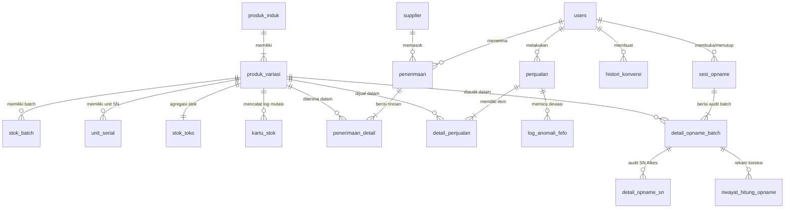
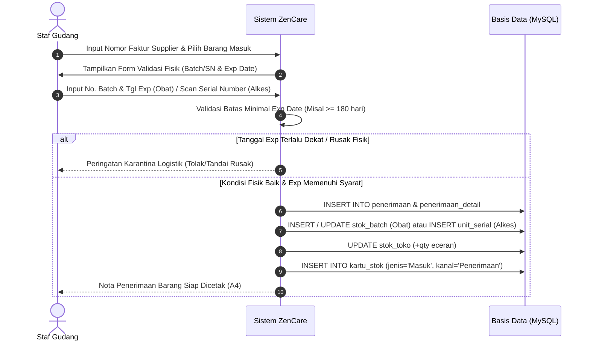
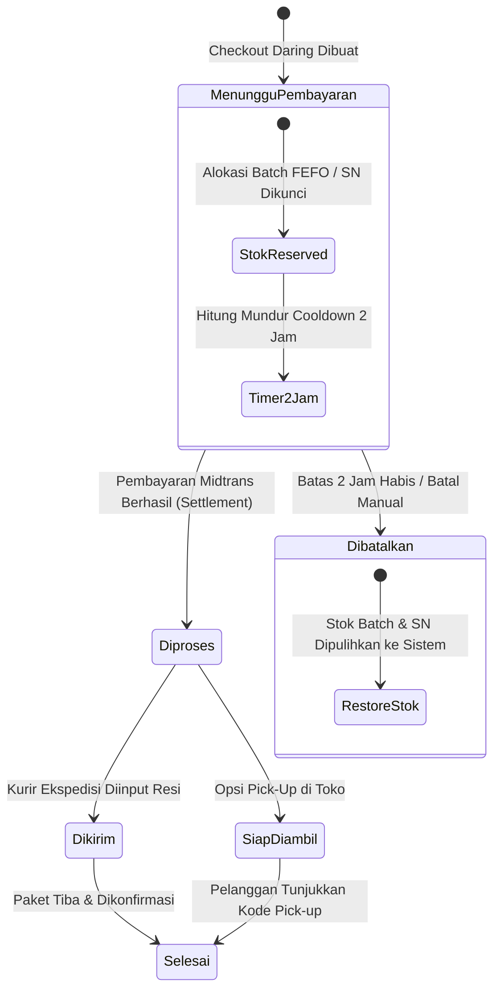

# DOKUMEN SPESIFIKASI KEBUTUHAN PERANGKAT LUNAK (SRS)
## SISTEM INFORMASI INVENTORI & POS OMNICHANNEL DISTRIBUTOR FARMASI & ALKES
### "ZENCARE MEDICAL"

---

## DAFTAR ISI
1. [PENDAHULUAN & RUANG LINGKUP SISTEM](#1-pendahuluan--ruang-lingkup-sistem)
2. [DESKRIPSI UMUM SISTEM & ATURAN BISNIS KHUSUS](#2-deskripsi-umum-sistem--aturan-bisnis-khusus)
   - 2.1 Pembedaan Komoditas Medis (Obat vs Alat Kesehatan)
   - 2.2 Hierarki Produk & Konversi Satuan Bertingkat (UOM)
   - 2.3 Mekanisme FEFO (First Expired, First Out) & Audit Anomali
   - 2.4 Mekanisme Serial Number (SN) Unit Alkes
   - 2.5 Arsitektur Omnichannel (Sinkronisasi POS Kasir & E-Commerce)
   - 2.6 Mekanisme Stok Opname Terisolasi (Freezing Session)
3. [DESAIN BASIS DATA LENGKAP (DATABASE ARCHITECTURE)](#3-desain-basis-data-lengkap-database-architecture)
   - 3.1 Entity Relationship Diagram (ERD Logic)
   - 3.2 Kamus Data & Struktur Seluruh Tabel Basis Data
4. [SPESIFIKASI KEBUTUHAN FUNGSIONAL & ALUR SISTEM DETAIL](#4-spesifikasi-kebutuhan-fungsional--alur-sistem-detail)
   - 4.1 Modul Penerimaan Logistik (Inbound & Validasi Kedaluwarsa)
   - 4.2 Modul Konversi UOM (Bongkar Satuan Besar & Lahir Sub-Batch)
   - 4.3 Modul Transaksi Kasir POS (Offline Point-of-Sale)
   - 4.4 Modul E-Commerce & Reservasi Stok Otomatis (Cooldown 2 Jam)
   - 4.5 Modul Manajemen Pesanan & Pemenuhan Fisik (Fulfillment)
   - 4.6 Modul Stok Opname, Rekonsiliasi, & Freeze Bypass Prevention
   - 4.7 Modul Mutasi Stok Manual & Klaim Garansi
   - 4.8 Modul Kartu Stok & Audit Mutasi Fisik
5. [MATRIKS HAK AKSES PENGGUNA (ROLE-BASED ACCESS CONTROL)](#5-matriks-hak-akses-pengguna-role-based-access-control)
6. [PERSYARATAN NON-FUNGSIONAL & ARSITEKTUR TEKNOLOGI](#6-persyaratan-non-fungsional--arsitektur-teknologi)

---

## 1. PENDAHULUAN & RUANG LINGKUP SISTEM

### 1.1 Tujuan Dokumen
Dokumen Software Requirements Specification (SRS) ini disusun secara komprehensif untuk mendokumentasikan seluruh arsitektur perangkat lunak, aturan bisnis farmasi/alkes, model data relasional, dan logika alur kerja transaksi pada sistem **ZenCare Medical**. Dokumen ini menjadi rujukan teknis utama dalam penyusunan laporan Tugas Akhir (TA) serta integrasi dengan LLM (Gemini / Claude).

### 1.2 Identitas Entitas Bisnis
- **Nama Usaha**: ZenCare Medical
- **Bidang**: Distributor Resmi Obat-obatan Kemasan Grosir & Alat Kesehatan
- **Alamat Resmi**: Jl. Muharto No. 55D, Jodipan, Kec. Blimbing, Kota Malang, Jawa Timur 65127
- **Kontak Resmi**: WhatsApp/Telp 0895-3434-36025 | Email: `zencare.id@gmail.com`
- **Model Bisnis**: Omnichannel (Toko Fisik / POS Kasir + Platform E-Commerce Daring)

---

## 2. DESKRIPSI UMUM SISTEM & ATURAN BISNIS KHUSUS

ZenCare Medical mengelola dua jenis komoditas medis yang memiliki regulasi dan karakteristik fisik berbeda:

```
                          ┌───────────────────────────┐
                          │   PRODUK ZENCARE MEDICAL  │
                          └─────────────┬─────────────┘
                                        │
                ┌───────────────────────┴───────────────────────┐
                ▼                                               ▼
       ┌──────────────────┐                           ┌───────────────────┐
       │     KATEGORI     │                           │     KATEGORI      │
       │       OBAT       │                           │  ALAT KESEHATAN   │
       └────────┬─────────┘                           └─────────┬─────────┘
                │                                               │
   ┌────────────┴────────────┐                     ┌────────────┴────────────┐
   │ • Tracking: Batch & Exp │                     │ • Tracking: Serial No   │
   │ • Metode: FEFO          │                     │ • Garansi: Exp Date SN  │
   │ • Satuan: Besar & Kecil │                     │ • Satuan: Unit Tunggal  │
   │ • Sub-Batch: .A, .B...  │                     │ • Fisik: Barcode SN     │
   └─────────────────────────┘                     └─────────────────────────┘
```

### 2.1 Pembedaan Komoditas Medis (Obat vs Alat Kesehatan)
1. **Komoditas Obat**:
   - Memiliki **Nomor Batch Pabrik** dan **Tanggal Kedaluwarsa (Expired Date)**.
   - Mengikuti kaidah **FEFO (First Expired, First Out)** secara ketat.
   - Memiliki struktur satuan ganda: **Satuan Besar** (Karton / Dus / Box) dan **Satuan Kecil** (Strip / Botol / Tablet).
2. **Komoditas Alat Kesehatan (Alkes)**:
   - Tidak mengenal nomor batch, melainkan dilacak secara individual menggunakan **Nomor Seri Unik (Serial Number / SN)** per unit fisik.
   - Status setiap unit SN dilacak: `Tersedia`, `Terjual`, `Retur/Rusak`, atau `Hilang`.
   - Menggunakan tanggal kedaluwarsa garansi pabrik (*tgl_habis_garansi*).

### 2.2 Hierarki Produk & Konversi Satuan Bertingkat (UOM)
Sistem memisahkan entitas katalog menjadi dua tingkat:
- **Produk Induk (`produk_induk`)**: Menyimpan metadata umum seperti nama produk (`Amoxicillin 500mg`), kategori (`Obat` / `Alat Kesehatan`), gambar, dan deskripsi umum.
- **Produk Variasi (`produk_variasi`)**: Menyimpan varian fisik dan aturan konversi satuan:
  - `satuan_besar`: Satuan grosir/distribusi (misal: Karton, Dus, Box).
  - `satuan_kecil`: Satuan eceran/konsumsi (misal: Strip, Botol, Pcs).
  - `rasio_konversi`: Jumlah satuan kecil di dalam 1 satuan besar (misal: 1 Box = 10 Strip, maka `rasio_konversi = 10`).
  - `harga_jual_besar` & `harga_jual_kecil`: Harga jual masing-masing satuan.
  - `stok_minimum_besar` & `stok_minimum_kecil`: Batas Reorder Point (ROP).

#### Aturan Pemisahan Stok Fisik:
- **Tabel `stok_toko`**: Menyimpan total stok dalam **satuan terkecil (base unit / pcs)** untuk agregasi cepat e-commerce & kasir.
- **Tabel `stok_batch`**: Menyimpan persediaan fisik obat per nomor batch:
  - **Batch Induk (Satuan Besar)**: Nomor batch asli dari pabrik (misal `AMX-2026-01`), stok disimpan dalam ekuivalen pcs utuh.
  - **Sub-Batch (Satuan Kecil)**: Hasil pembongkaran kemasan besar menggunakan notasi titik (misal `AMX-2026-01.A`, `AMX-2026-01.B`).

### 2.3 Mekanisme FEFO (First Expired, First Out) & Audit Anomali
1. Setiap kali terjadi penjualan obat (baik di POS Kasir maupun E-Commerce), sistem secara otomatis mengurutkan batch yang tersedia dengan kriteria:
   $$\text{ORDER BY } tgl\_exp \text{ ASC, } id \text{ ASC}$$
2. Batch yang tanggal kedaluwarsanya paling dekat **wajib dikeluarkan terlebih dahulu**.
3. **Pencatatan Anomali FEFO (`log_anomali_fefo`)**:
   Jika kasir di POS memilih batch yang kedaluwarsanya lebih lama daripada batch terdekat yang masih ada stoknya (misal karena permintaan khusus pelanggan atau ketidaktelitian staf):
   - Transaksi **tetap diizinkan selesai** agar operasional kasir tidak terhenti di depan pelanggan.
   - Sistem secara otomatis mencatat deviasi ini ke tabel `log_anomali_fefo` dengan status `terlewat`, mencatat `batch_diambil` vs `batch_seharusnya`.
   - Modul manajerial akan menampilkan indikator peringatan deviasi FEFO hingga disesuaikan (*reconciliation*).

### 2.4 Mekanisme Serial Number (SN) Unit Alkes
1. Pada saat penerimaan barang Alkes, operator memasukkan/memindai Serial Number satu per satu.
2. Setiap Serial Number dicatat dalam tabel `unit_serial` dengan status `Tersedia`.
3. Pada saat checkout POS Kasir atau pengemasan pesanan E-Commerce, operator memindai barcode SN unit yang diambil.
4. Sistem memvalidasi keunikan dan status SN:
   - Jika SN valid & `Tersedia`: status berubah menjadi `Terjual` dan mengaitkan `id_penjualan`.
   - Jika Alkes rusak atau retur garansi: status berubah menjadi `Retur/Rusak`.

### 2.5 Arsitektur Omnichannel (Sinkronisasi POS Kasir & E-Commerce)
1. **Single Source of Truth**: Seluruh transaksi online dan offline memotong stok dari inventori terpusat di Cabang Muharto.
2. **Kanal Transaksi**:
   - `POS`: Transaksi kasir offline langsung di toko. Pelanggan walk-in, pembayaran tunai/QRIS/kartu, langsung memotong fisik saat kasir klik bayar.
   - `E-Commerce`: Transaksi pelanggan via website. Menggunakan metode pengiriman kurir ekspedisi (JNE, POS, TIKI) atau opsi Pick-up (Ambil Sendiri di Toko).
3. **Mekanisme Reservasi Stok Otomatis (Cooldown 2 Jam)**:
   - Ketika pelanggan melakukan checkout daring, pesanan berstatus `Menunggu Pembayaran`.
   - Stok sistem dan alokasi batch/SN langsung **dikunci (Reserved)** agar tidak terjual ke kasir POS atau pelanggan online lain.
   - Diberikan batas waktu pembayaran **2 jam**. Jika dalam 2 jam belum dibayar (status Midtrans expired/batal), sistem secara otomatis memulihkan stok yang di-reserved kembali menjadi tersedia.

### 2.6 Mekanisme Stok Opname Terisolasi (Freezing Session)
Untuk mencegah *race condition* (selisih stok akibat transaksi berjalan saat penghitungan fisik dilakukan):
1. Saat SuperAdmin/Admin mengaktifkan sesi opname (`sesi_opname.status = 'Aktif'`), seluruh aktivitas transaksi kasir POS, checkout e-commerce, penerimaan barang, dan mutasi manual **DIBEKUKAN SEMENTARA (SYSTEM LOCKOUT)**.
2. Setiap fungsi transaksi memeriksa `cekSesiOpnameAktif($pdo)`:
   - Jika sesi aktif terdeteksi, transaksi langsung ditolak dengan pesan error resmi dan banner peringatan di seluruh sistem.
3. Setelah seluruh fisik selesai dihitung dan disetujui, sesi opname ditutup (`Selesai`), rekonsiliasi kartu stok dicatat otomatis, dan sistem kembali dibuka untuk transaksi.

---

## 3. DESAIN BASIS DATA LENGKAP (DATABASE ARCHITECTURE)

### 3.1 Entity Relationship Diagram (ERD Logic)



---

### 3.2 Kamus Data & Struktur Seluruh Tabel Basis Data

#### 1. Tabel `users` (Pengguna Sistem & Pelanggan)
| Kolom | Tipe Data | Null | Key | Default | Deskripsi Fungsional |
|---|---|---|---|---|---|
| `id` | int(11) | NO | PRI | auto_increment | Primary key pengguna |
| `username` | varchar(50) | NO | UNI | NULL | Username login staf / pelanggan |
| `password` | varchar(255) | NO | - | NULL | Password terenkripsi (Bcrypt hash) |
| `nama_lengkap` | varchar(100) | NO | - | NULL | Nama lengkap pengguna |
| `role` | enum('superadmin','admin','kasir','pelanggan') | NO | - | NULL | Hak akses pengguna |
| `email` | varchar(150) | YES | - | NULL | Alamat email terdaftar |
| `telepon` | varchar(20) | YES | - | NULL | Nomor kontak / WhatsApp |
| `alamat` | text | YES | - | NULL | Alamat fisik pengiriman default |
| `kota_id` | int(11) | YES | - | NULL | ID kota RajaOngkir untuk ongkir otomatis |
| `is_active` | tinyint(1) | YES | - | 1 | Status aktif akun (1=Aktif, 0=Nonaktif) |
| `created_at` | timestamp | NO | - | CURRENT_TIMESTAMP | Waktu pendaftaran akun |

#### 2. Tabel `produk_induk` (Katalog Induk Komoditas)
| Kolom | Tipe Data | Null | Key | Default | Deskripsi Fungsional |
|---|---|---|---|---|---|
| `id` | int(11) | NO | PRI | auto_increment | Primary key produk induk |
| `sku_induk` | varchar(50) | NO | UNI | NULL | Kode unik SKU induk (misal: `PRD-AMX`) |
| `nama_produk` | varchar(150) | NO | - | NULL | Nama produk medis (misal: `Amoxicillin 500mg`) |
| `deskripsi` | text | YES | - | NULL | Deskripsi klinis, indikasi, dan pemakaian |
| `spesifikasi` | text | YES | - | NULL | Spesifikasi teknis atau aturan penyimpanan |
| `info_pengiriman` | text | YES | - | NULL | Instruksi penanganan pengiriman khusus |
| `kategori` | enum('Obat','Alat Kesehatan') | NO | - | NULL | Klasifikasi komoditas medis |
| `gambar` | varchar(255) | YES | - | NULL | Nama file path gambar utama produk |
| `is_active` | tinyint(1) | YES | - | 1 | Status tayang katalog (1=Aktif, 0=Nonaktif) |
| `batas_hari_expired` | int(11) | YES | - | 0 | Batas toleransi hari kedaluwarsa diterima |
| `created_at` | timestamp | NO | - | CURRENT_TIMESTAMP | Waktu pencatatan data induk |

#### 3. Tabel `produk_variasi` (Varian Kemasan, UOM & Harga)
| Kolom | Tipe Data | Null | Key | Default | Deskripsi Fungsional |
|---|---|---|---|---|---|
| `id` | int(11) | NO | PRI | auto_increment | Primary key variasi |
| `id_produk_induk` | int(11) | YES | MUL | NULL | FK ke `produk_induk.id` |
| `sku_variasi` | varchar(50) | NO | UNI | NULL | SKU barcode varian (misal: `AMX-500-TAB`) |
| `nama_variasi` | varchar(100) | NO | - | NULL | Nama variasi kemasan (misal: `Tablet 500mg`) |
| `satuan_kecil` | varchar(50) | NO | - | 'Pcs' | Nama satuan eceran/base (Strip, Botol, Pcs) |
| `satuan_besar` | varchar(50) | NO | - | 'Box' | Nama satuan grosir (Box, Dus, Karton) |
| `rasio_konversi` | smallint(6) | NO | - | 1 | Pengali satuan besar ke kecil (1 Box = n Pcs) |
| `harga_jual_kecil` | decimal(12,2) | NO | - | 0.00 | Harga per satuan kecil (Kasir POS) |
| `harga_jual_besar` | decimal(12,2) | NO | - | 0.00 | Harga per satuan besar (E-Commerce/Grosir) |
| `stok_minimum_kecil`| int(11) | YES | - | 0 | Batas ROP satuan kecil (peringatan eceran) |
| `stok_minimum_besar`| int(11) | YES | - | 0 | Batas ROP satuan besar (peringatan dus utuh) |
| `berat` | int(11) | NO | - | 100 | Berat pengiriman dalam gram per satuan besar |
| `tampil_di_online` | tinyint(1) | YES | - | 1 | Flag tampil di toko online (1=Ya, 0=Tidak) |
| `is_active` | tinyint(1) | YES | - | 1 | Status aktif variasi SKU |
| `gambar` | varchar(500) | YES | - | NULL | URL / path foto spesifik variasi |

#### 4. Tabel `stok_batch` (Penyimpanan Lot/Batch Farmasi & FEFO)
| Kolom | Tipe Data | Null | Key | Default | Deskripsi Fungsional |
|---|---|---|---|---|---|
| `id` | int(11) | NO | PRI | auto_increment | Primary key nomor batch |
| `id_variasi` | int(11) | NO | MUL | NULL | FK ke `produk_variasi.id` |
| `no_batch` | varchar(100) | NO | - | NULL | Nomor lot batch pabrik / sub-batch |
| `tgl_exp` | date | NO | - | NULL | Tanggal kedaluwarsa batch |
| `stok_sisa` | int(11) | NO | - | 0 | Sisa kuantitas fisik batch (satuan kecil) |
| `created_at` | timestamp | NO | - | CURRENT_TIMESTAMP | Waktu pencatatan lot batch |

#### 5. Tabel `unit_serial` (Penyimpanan Nomor Seri Fisik Alkes)
| Kolom | Tipe Data | Null | Key | Default | Deskripsi Fungsional |
|---|---|---|---|---|---|
| `id` | int(11) | NO | PRI | auto_increment | Primary key unit serial |
| `id_variasi` | int(11) | NO | MUL | NULL | FK ke `produk_variasi.id` |
| `serial_number` | varchar(150) | NO | UNI | NULL | Nomor seri fisik unik unit pabrikan |
| `status` | enum('Tersedia','Terjual','Retur/Rusak','Hilang') | NO | - | 'Tersedia' | Status keberadaan unit fisik |
| `id_penjualan` | int(11) | YES | - | NULL | FK ke `penjualan.id` saat terjual |
| `catatan` | varchar(255) | YES | - | NULL | Catatan kondisi fisik unit |
| `tgl_habis_garansi` | date | YES | - | NULL | Tanggal habis masa garansi resmi |
| `created_at` | timestamp | NO | - | CURRENT_TIMESTAMP | Waktu unit pertama kali didaftarkan |
| `updated_at` | timestamp | YES | - | NULL | Waktu perubahan status unit |

#### 6. Tabel `stok_toko` (Tabel Akumulasi Stok Cepat)
| Kolom | Tipe Data | Null | Key | Default | Deskripsi Fungsional |
|---|---|---|---|---|---|
| `id` | int(11) | NO | PRI | auto_increment | Primary key |
| `id_variasi` | int(11) | NO | UNI | NULL | FK ke `produk_variasi.id` (1 row per variasi) |
| `stok` | int(11) | NO | - | 0 | Total stok ekuivalen satuan kecil |

#### 7. Tabel `penjualan` (Header Transaksi POS & E-Commerce)
| Kolom | Tipe Data | Null | Key | Default | Deskripsi Fungsional |
|---|---|---|---|---|---|
| `id` | int(11) | NO | PRI | auto_increment | Primary key transaksi |
| `no_invoice` | varchar(50) | NO | UNI | NULL | No unik faktur (misal: `INV-20261104-001`) |
| `id_user` | int(11) | YES | MUL | NULL | FK ke `users.id` (kasir/pelanggan) |
| `tipe_transaksi` | enum('pos','ecommerce','shopee') | NO | - | 'pos' | Kanal asal transaksi |
| `metode_pengambilan`| enum('Pick-up','Kirim') | NO | - | 'Pick-up' | Metode penyerahan barang fisik |
| `status_pesanan` | enum('Menunggu Pembayaran','Diproses','Siap Diambil','Dikirim','Selesai','Dibatalkan') | NO | - | 'Menunggu Pembayaran' | Status alur pesanan |
| `total_harga` | decimal(12,2) | NO | - | NULL | Total tagihan akhir transaksi |
| `metode_pembayaran`| varchar(50) | YES | - | NULL | Tunai, QRIS, Midtrans VA, dll |
| `ongkir` | decimal(10,2) | YES | - | 0.00 | Biaya pengiriman logistik |
| `nama_penerima` | varchar(100) | YES | - | NULL | Nama orang yang menerima paket |
| `telepon_penerima` | varchar(20) | YES | - | NULL | No HP tujuan pengiriman |
| `alamat_lengkap` | text | YES | - | NULL | Alamat tujuan kirim |
| `kota_tujuan` | varchar(100) | YES | - | NULL | Kota/Kabupaten tujuan |
| `kurir` | varchar(50) | YES | - | NULL | Ekspedisi (JNE, POS, TIKI, Kurir Toko) |
| `layanan` | varchar(50) | YES | - | NULL | Service kurir (REG, OKE, YES, Direct) |
| `no_resi` | varchar(100) | YES | - | NULL | Nomor tanda terima ekspedisi |
| `kode_pickup` | varchar(20) | YES | - | NULL | PIN verifikasi pengambilan barang di toko |
| `created_at` | timestamp | NO | - | CURRENT_TIMESTAMP | Waktu pembuatan transaksi |
| `paid_at` | timestamp | YES | - | NULL | Waktu verifikasi pelunasan |
| `request_batal` | tinyint(1) | YES | - | 0 | Flag pelanggan minta batal (1=Ya) |
| `request_batal_alasan`| text | YES | - | NULL | Alasan pembatalan dari pelanggan |

#### 8. Tabel `detail_penjualan` (Rincian Item Transaksi)
| Kolom | Tipe Data | Null | Key | Default | Deskripsi Fungsional |
|---|---|---|---|---|---|
| `id` | int(11) | NO | PRI | auto_increment | Primary key item |
| `id_penjualan` | int(11) | NO | MUL | NULL | FK ke `penjualan.id` |
| `id_variasi` | int(11) | NO | MUL | NULL | FK ke `produk_variasi.id` |
| `qty` | int(11) | NO | - | NULL | Kuantitas transaksi sesuai satuan transaksi |
| `harga_satuan` | decimal(12,2) | NO | - | NULL | Harga per unit saat transaksi terjadi |
| `catatan_logistik` | text | YES | - | NULL | Rincian batch FEFO / SN yang diambil fisik |

#### 9. Tabel `kartu_stok` (Buku Besar Mutasi Fisik Persediaan)
| Kolom | Tipe Data | Null | Key | Default | Deskripsi Fungsional |
|---|---|---|---|---|---|
| `id` | int(11) | NO | PRI | auto_increment | Primary key buku mutasi |
| `id_variasi` | int(11) | NO | MUL | NULL | FK ke `produk_variasi.id` |
| `id_batch` | int(11) | YES | MUL | NULL | FK ke `stok_batch.id` jika mutasi obat |
| `satuan_tipe` | enum('besar','kecil') | NO | - | 'kecil' | Satuan kartu stok yang dipengaruhi |
| `jenis_mutasi` | enum('Masuk','Keluar','Penyesuaian') | NO | - | NULL | Arah pergerakan fisik barang |
| `kanal` | enum('POS','E-Commerce','Manual','Penerimaan','PO') | NO | - | 'Manual' | Kanal pemicu mutasi barang |
| `alasan_mutasi` | enum('Penerimaan Barang','Penjualan POS','Penjualan E-Commerce','Retur Barang Rusak','Klaim Garansi SN','Selisih Stok Opname','Barang Rusak','Barang Kedaluwarsa','Barang Hilang','Koreksi Salah Catat / Ditemukan','Koreksi Manual') | NO | - | 'Selisih Stok Opname' | Klasifikasi audit mutasi |
| `no_ref_dokumen` | varchar(100) | YES | - | NULL | No Faktur / PO / Sesi Opname terkait |
| `qty` | int(11) | NO | - | NULL | Kuantitas pergerakan mutasi fisik |
| `sisa_stok` | int(11) | NO | - | NULL | Saldo akhir riil fisik setelah mutasi |
| `keterangan` | text | YES | - | NULL | Deskripsi detail aktivitas mutasi |
| `dibuat_oleh` | int(11) | YES | MUL | NULL | FK ke `users.id` yang mengeksekusi |
| `tanggal` | timestamp | NO | - | CURRENT_TIMESTAMP | Waktu pencatatan mutasi fisik |

#### 10. Tabel `sesi_opname` (Header Audit Fisik & Pembekuan Sistem)
| Kolom | Tipe Data | Null | Key | Default | Deskripsi Fungsional |
|---|---|---|---|---|---|
| `id` | int(11) | NO | PRI | auto_increment | Primary key sesi opname |
| `kode_sesi` | varchar(50) | NO | UNI | NULL | Kode sesi (misal: `OPN-20261104-001`) |
| `status` | enum('Aktif','Selesai','Dibatalkan') | NO | - | 'Aktif' | Status sesi opname |
| `dibekukan_oleh` | int(11) | NO | MUL | NULL | FK `users.id` yang memulai freeze |
| `dibekukan_pada` | timestamp | NO | - | CURRENT_TIMESTAMP | Waktu sistem mulai dibekukan |
| `dibuka_oleh` | int(11) | YES | MUL | NULL | FK `users.id` yang menyelesaikan |
| `dibuka_pada` | timestamp | YES | - | NULL | Waktu sistem dibuka kembali |
| `catatan` | text | YES | - | NULL | Keterangan ruang lingkup audit |

#### 11. Tabel `detail_opname_batch` (Rincian Audit Fisik Obat & Alkes)
| Kolom | Tipe Data | Null | Key | Default | Deskripsi Fungsional |
|---|---|---|---|---|---|
| `id` | int(11) | NO | PRI | auto_increment | Primary key detail opname |
| `id_sesi` | int(11) | NO | MUL | NULL | FK ke `sesi_opname.id` |
| `id_batch` | int(11) | YES | MUL | NULL | FK ke `stok_batch.id` (Obat) |
| `id_variasi` | int(11) | NO | MUL | NULL | FK ke `produk_variasi.id` |
| `jenis_komoditas`| enum('Obat','Alkes') | NO | - | 'Obat' | Komoditas yang dihitung |
| `satuan_tipe` | enum('besar','kecil') | NO | - | 'kecil' | Satuan penghitungan fisik |
| `nama_satuan` | varchar(50) | NO | - | 'Unit' | Label teks satuan (Box/Strip/Unit) |
| `stok_tersedia_sistem` | int(11) | NO | - | NULL | Stok bebas sistem saat freeze |
| `stok_reserved` | int(11) | NO | - | NULL | Stok yang sedang dipesan belum selesai |
| `stok_sistem_fisik` | int(11) | NO | - | NULL | Total stok fisik teoritis di gudang |
| `hitung_fisik` | int(11) | YES | - | NULL | Hasil cacah fisik oleh staf gudang |
| `selisih` | int(11) | YES | - | NULL | `hitung_fisik - stok_sistem_fisik` |
| `status_mutasi` | enum('Belum Dimutasi','Sudah Dimutasi','Sesuai') | NO | - | 'Belum Dimutasi' | Status rekonsiliasi |
| `alasan_mutasi` | varchar(255) | YES | - | NULL | Alasan jika terjadi selisih |
| `dihitung_oleh` | int(11) | YES | MUL | NULL | FK `users.id` pemeriksa fisik |

#### 12. Tabel `detail_opname_sn` (Audit Detail Serial Number Alkes Saat Opname)
| Kolom | Tipe Data | Null | Key | Default | Deskripsi Fungsional |
|---|---|---|---|---|---|
| `id` | int(11) | NO | PRI | auto_increment | Primary key |
| `id_detail_opname`| int(11) | NO | MUL | NULL | FK ke `detail_opname_batch.id` |
| `id_unit_serial` | int(11) | YES | MUL | NULL | FK ke `unit_serial.id` |
| `serial_number` | varchar(100) | NO | MUL | NULL | Serial number yang diverifikasi |
| `jenis_tindakan` | enum('Kurang_Rusak','Kurang_Hilang','Tambah_Ditemukan') | NO | - | NULL | Tindakan rekonsiliasi SN |

#### 13. Tabel `log_anomali_fefo` (Pencatatan Audit Pelanggaran Urutan Kedaluwarsa)
| Kolom | Tipe Data | Null | Key | Default | Deskripsi Fungsional |
|---|---|---|---|---|---|
| `id` | int(11) | NO | PRI | auto_increment | Primary key log anomali |
| `id_penjualan` | int(11) | YES | - | NULL | FK transaksi penjualan yang memicu |
| `id_user` | int(11) | NO | - | NULL | FK user kasir yang melayani |
| `id_variasi` | int(11) | NO | - | NULL | FK variasi produk obat |
| `batch_diambil` | varchar(100) | YES | - | NULL | Nomor batch yang dipilih kasir |
| `batch_seharusnya`| varchar(100) | YES | - | NULL | Nomor batch terdekat yang dilewati |
| `qty` | int(11) | YES | - | NULL | Jumlah unit yang tidak taat FEFO |
| `status` | enum('terlewat','sebagian','disesuaikan') | NO | - | 'terlewat' | Status tindak lanjut manajerial |

#### 14. Tabel `histori_konversi` (Log Pemecahan Satuan Besar ke Satuan Kecil)
| Kolom | Tipe Data | Null | Key | Default | Deskripsi Fungsional |
|---|---|---|---|---|---|
| `id` | int(11) | NO | PRI | auto_increment | Primary key konversi |
| `id_variasi` | int(11) | NO | MUL | NULL | FK ke `produk_variasi.id` |
| `batch_asal` | varchar(100) | NO | - | NULL | Batch kemasan besar yang dibuka |
| `batch_hasil` | varchar(100) | NO | - | NULL | Sub-batch kemasan kecil yang tercipta |
| `qty_box_buka` | int(11) | NO | - | NULL | Jumlah kemasan besar yang dipecah |
| `qty_pcs_hasil` | int(11) | NO | - | NULL | Hasil kemasan kecil (`qty_box * rasio`) |
| `dibuat_oleh` | int(11) | YES | MUL | NULL | FK `users.id` operator pembongkaran |
| `created_at` | timestamp | NO | - | CURRENT_TIMESTAMP | Waktu pembongkaran dilakukan |

#### 15. Tabel `penerimaan` & `penerimaan_detail` (Inbound Logistik dari PBF/Supplier)
- **`penerimaan`**: Header penerimaan logistik mencatat `no_penerimaan`, `id_supplier`, `no_faktur_supplier`, `tgl_terima`, `total_nilai`, dan status verifikasi penerimaan.
- **`penerimaan_detail`**: Rincian barang masuk per baris mencatat `id_variasi`, `qty_pesan`, `qty_terima`, `qty_rusak`, `no_batch`, `tgl_exp`, dan `status_kondisi`.

#### 16. Tabel `pengaturan_web` (Konfigurasi Profil Toko Resmi)
Mencatat konfigurasi global instansi ZenCare Medical: `nama_toko`, `deskripsi`, `telepon` (`0895343436025`), `whatsapp` (`62895343436025`), `email_cs` (`zencare.id@gmail.com`), dan `alamat` (`Jl. Muharto No. 55D, Jodipan, Kec. Blimbing, Kota Malang 65127`).

---

## 4. SPESIFIKASI KEBUTUHAN FUNGSIONAL & ALUR SISTEM DETAIL

### 4.1 Modul Penerimaan Logistik (Inbound & Validasi Kedaluwarsa)


### 4.2 Modul Konversi UOM (Bongkar Satuan Besar & Lahir Sub-Batch)
1. **Pemicu**: Stok satuan kecil (eceran) di etalase habis, namun masih terdapat kemasan besar utuh di gudang.
2. **Logika Eksekusi Transaksi Database**:
   - Memilih 1 (atau $n$) Dus dari batch obat tertua (FEFO).
   - Mengurangi kuantitas fisik pada batch induk sebesar $n \times \text{rasio}$.
   - Membuat/menambah kuantitas pada sub-batch bertanda notasi titik:
     $$\text{Kode Sub-Batch} = \text{BatchAsal} + \text{".A" (atau huruf alfabet berikutnya)}$$
   - Mencatat log pada tabel `histori_konversi`.
   - Mencatat 2 mutasi pada `kartu_stok`:
     1. Mutasi Keluar pada Kartu Stok (Satuan Besar): $-n\text{ Box}$.
     2. Mutasi Masuk pada Kartu Stok (Satuan Kecil): $+(n \times \text{rasio})\text{ Strip/Pcs}$.

### 4.3 Modul Transaksi Kasir POS (Offline Point-of-Sale)
1. Kasir memindai barcode SKU variasi atau mencari nama produk.
2. Jika produk adalah **Obat**:
   - Sistem otomatis mengalokasikan batch terdekat (FEFO) dan menampilkan rekomendasi di layar kasir.
   - Jika stok eceran kosong, sistem menampilkan modal konfirmasi pembongkaran kemasan dus instan.
   - Jika kasir mengganti batch secara manual, sistem mengecek apakah ada batch lebih tua yang terlewat. Jika terlewat, sistem memicu pencatatan ke `log_anomali_fefo`.
3. Jika produk adalah **Alkes**:
   - Kasir wajib memindai/memilih nomor seri fisik unik (SN) unit yang diambil.
4. Saat tombol **Bayar** diklik:
   - Sistem memotong kuantitas pada `stok_batch` (atau mengupdate `unit_serial.status = 'Terjual'`).
   - Memotong kuantitas akumulasi di `stok_toko`.
   - Mencatat penjualan ke `penjualan` dan `detail_penjualan` dengan status `Selesai`.
   - Mencatat mutasi keluar pada `kartu_stok` (`kanal = 'POS'`).
   - Mencetak struk kasir thermal (80mm/58mm) atau faktur penjualan A4.

### 4.4 Modul E-Commerce & Reservasi Stok Otomatis (Cooldown 2 Jam)


### 4.5 Modul Manajemen Pesanan & Pemenuhan Fisik (Fulfillment)
1. Operator logistik membuka menu **Transaksi** ([admin/pesanan.php](file:///c:/xampp/htdocs/inventory_zencare/admin/pesanan.php)).
2. Membuka detail pesanan berstatus `Diproses`.
3. Sistem menyajikan **Instruksi Ambil Fisik (Picking List)** yang mencantumkan:
   - Nama produk & variasi.
   - Kuantitas yang harus diambil dalam kedua satuan (misal: `1 Box (10 Strip)`).
   - **Nomor batch spesifik** yang harus diambil dari rak (lengkap dengan sisa hari kedaluwarsa).
   - **Nomor seri unit (SN)** yang harus diambil (khusus Alkes).
4. Operator mencetak:
   - **Faktur Penjualan Kertas A4** ([pos/cetak_invoice.php](file:///c:/xampp/htdocs/inventory_zencare/pos/cetak_invoice.php)).
   - **Stiker Label Thermal 100x150mm** ([admin/cetak_label_pengiriman.php](file:///c:/xampp/htdocs/inventory_zencare/admin/cetak_label_pengiriman.php)) yang memuat barcode invoice, instruksi kurir, identitas pengirim/penerima, dan rincian alokasi fisik FEFO/SN.

### 4.6 Modul Stok Opname, Rekonsiliasi, & Freeze Bypass Prevention
1. **Inisiasi & Pembekuan**:
   - SuperAdmin membuka sesi opname baru.
   - Sistem mencatat snapshot fisik teoritis (`stok_sistem_fisik`) dari setiap batch obat dan unit serial alkes.
   - Seluruh modul transaksi dibekukan secara global.
2. **Pencacahan Fisik (Stock Counting)**:
   - Staf gudang menghitung fisik barang di rak penyimpanan.
   - Memasukkan angka `hitung_fisik` ke sistem.
   - Khusus Alkes: melakukan checklist fisik apakah unit SN ada, rusak, atau hilang.
3. **Rekonsiliasi Otomatis**:
   - Jika terdapat selisih ($\text{hitung} \neq \text{sistem}$):
     - Operator memilih alasan audit: `Barang Rusak`, `Barang Kedaluwarsa`, `Barang Hilang`, atau `Koreksi Salah Catat / Ditemukan`.
     - Sistem melakukan penyesuaian otomatis pada tabel `stok_batch` dan `stok_toko`.
     - Mencatat mutasi penyesuaian pada `kartu_stok` (`jenis_mutasi = 'Penyesuaian'`).
4. **Penutupan Sesi & Pembukaan Blokir**:
   - SuperAdmin menyetujui hasil opname.
   - Sistem mencetak **Berita Acara Hasil Pemeriksaan Fisik (Stok Opname)** bertandatangan resmi ([inventori/cetak_berita_acara_opname.php](file:///c:/xampp/htdocs/inventory_zencare/inventori/cetak_berita_acara_opname.php)).
   - Pembekuan dicabut dan transaksi kembali berjalan normal.

### 4.7 Modul Mutasi Stok Manual & Klaim Garansi
- Digunakan saat terjadi insiden di luar sesi opname (misal: botol sirup pecah saat penataan rak, obat rusak terkena lembab, atau klaim garansi Alkes).
- Operator memilih variasi, nomor batch spesifik, jumlah unit, serta alasan mutasi:
  - `Barang Rusak`
  - `Barang Kedaluwarsa`
  - `Klaim Garansi SN`
  - `Koreksi Manual`
- Transaksi database secara atomik memotong stok batch/SN dan mencatatnya ke kartu stok resmi.

### 4.8 Modul Kartu Stok & Audit Mutasi Fisik
- Sesuai standar audit distribusi farmasi dan alkes, sistem memisahkan buku mutasi fisik menjadi:
  1. **Kartu Stok (Satuan Besar)**: Melacak mutasi kardus utuh / box pabrik.
  2. **Kartu Stok (Satuan Kecil)**: Melacak mutasi strip, botol, tablet eceran, atau unit alkes.
- Dilengkapi dengan fitur **Backward Calculation Running Balance** untuk menghitung mundur saldo akhir secara akurat jika pengguna memfilter rentang tanggal tertentu atau memfilter kanal penjualan khusus (Omnichannel Filter).

---

## 5. MATRIKS HAK AKSES PENGGUNA (ROLE-BASED ACCESS CONTROL)

| Fitur / Modul Sistem | SuperAdmin (Pemilik) | Admin (Operasional) | Kasir (Front Office) | Pelanggan (Customer) |
|---|:---:|:---:|:---:|:---:|
| **Dashboard Manajerial & Grafik Kinerja** | Ya | Tidak | Tidak | Tidak |
| **Dashboard Operasional Harian** | Ya | Ya | Tidak | Tidak |
| **Kasir POS (Penjualan Walk-in)** | Ya | Tidak | Ya | Tidak |
| **Manajemen Pesanan E-Commerce** | Ya | Ya | Baca/Cetak | Tidak |
| **Penerimaan Barang Logistik (Inbound)**| Ya | Ya | Tidak | Tidak |
| **Konversi Satuan UOM (Bongkar Dus)** | Ya | Ya | Tidak | Tidak |
| **Mutasi Stok Manual (Barang Rusak)** | Ya | Ya | Tidak | Tidak |
| **Pelaksanaan Stok Opname (Counting)** | Ya | Ya | Tidak | Tidak |
| **Buka/Tutup Sesi Opname (Freeze Lock)**| Ya | Tidak | Tidak | Tidak |
| **Kartu Stok & Laporan Mutasi Fisik** | Ya | Ya | Tidak | Tidak |
| **Laporan Penjualan & Laba/Rugi** | Ya | Tidak | Tidak | Tidak |
| **Audit Anomali FEFO & Logistik Medis** | Ya | Ya | Tidak | Tidak |
| **Master Data (Produk, UOM, Supplier)**| Ya | Ya | Tidak | Tidak |
| **Manajemen Akun Pengguna Staf** | Ya | Tidak | Tidak | Tidak |
| **Katalog E-Commerce & Checkout Online**| Tidak | Tidak | Tidak | Ya |
| **Riwayat Pesanan Pelanggan Online** | Tidak | Tidak | Tidak | Ya |

---

## 6. PERSYARATAN NON-FUNGSIONAL & ARSITEKTUR TEKNOLOGI

1. **Arsitektur Aplikasi**: Monolithic MVC-pattern berbasis PHP Native 8.x dengan PDO MySQL Strict Mode.
2. **Basis Data**: MySQL/MariaDB dengan InnoDB Storage Engine (Mendukung ACID Transactions: `beginTransaction()`, `commit()`, `rollBack()`).
3. **Front-End & UI/UX**:
   - **Framework CSS**: Tailwind CSS (Utility-First) dengan palet brand resmi ZenCare (*Deep Navy `#0f2d5a`*, *Medical Blue `#1a75d2`*, dan *Medical Crimson `#c0392b`*).
   - **Tipografi**: Plus Jakarta Sans & Inter font family dengan ukuran teks minimal $\ge 11\text{px}$ untuk menjamin legibilitas klinis.
   - **Desain Responsif**: Menggunakan grid adaptif `repeat(auto-fit, minmax(...))` yang kompatibel mulai dari monitor desktop (1920x1080), laptop standar (1366x768 / 1280x720), hingga perangkat mobile/tablet e-commerce.
4. **Integrasi Pihak Ketiga (Third-Party APIs)**:
   - **Payment Gateway**: Midtrans Snap API (Virtual Account, QRIS, E-Wallet).
   - **Kalkulasi Ongkos Kirim**: RajaOngkir Pro/Starter API untuk kurir JNE, POS Indonesia, dan TIKI.
   - **Pencetakan Barcode**: JsBarcode library untuk render stiker thermal 100x150mm & faktur invoice A4.
5. **Keamanan & Integritas**:
   - Enkripsi kata sandi menggunakan `password_hash()` dengan algoritma Bcrypt.
   - Sanitasi data SQL menggunakan PDO Prepared Statements untuk pencegahan serangan SQL Injection.
   - Proteksi XSS pada seluruh form dan output tampilan menggunakan `htmlspecialchars()`.
   - Isolasi transaksi stok opname untuk mencegah inkonsistensi mutasi data (*Race Condition Prevention*).
